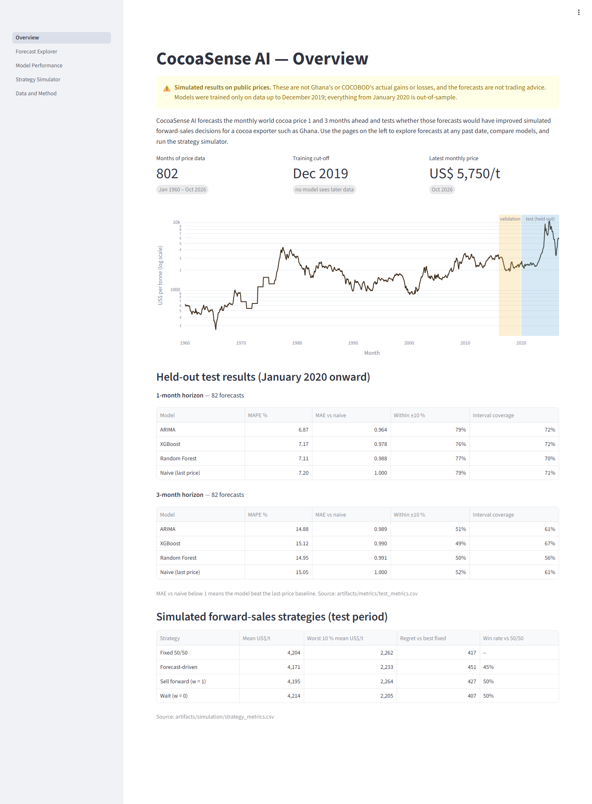
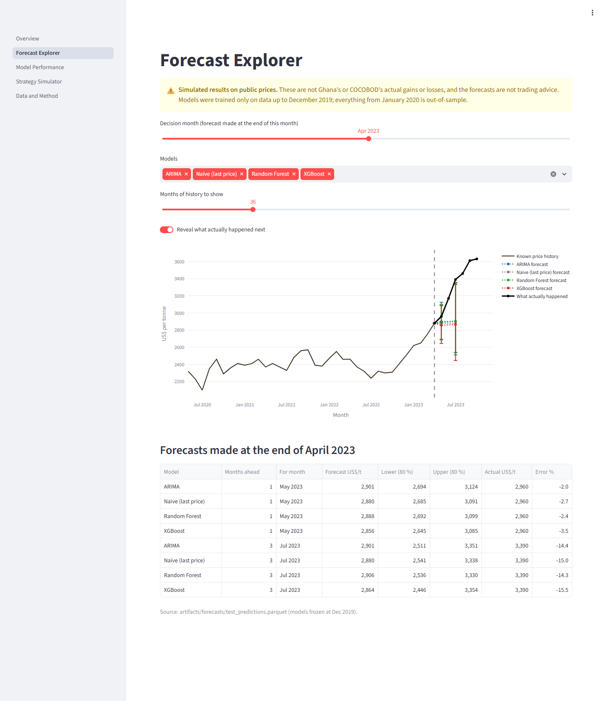
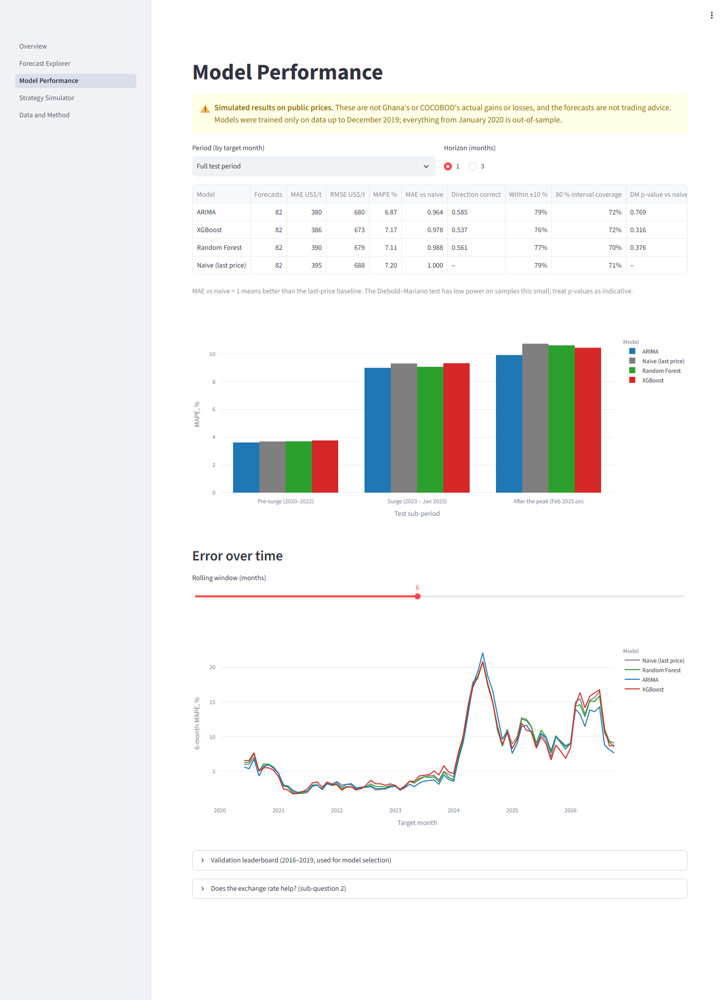
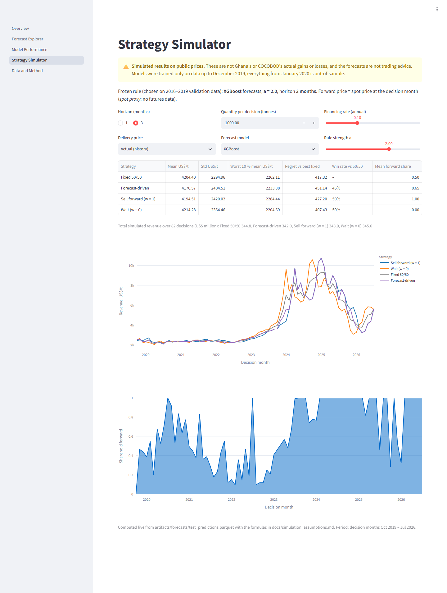

# CocoaSense AI

**Development and Evaluation of a Machine Learning-Based Cocoa Price Forecasting and
Forward-Sales Decision Support System for Ghana** — final-year project, Computer Science and
Engineering.

CocoaSense AI forecasts the monthly world cocoa price 1 and 3 months ahead with four models
(naive baseline, ARIMA, Random Forest, XGBoost), tests whether those forecasts would have improved
simulated forward-sales decisions, and presents everything in a Streamlit dashboard with a date
picker that shows only what was knowable on the chosen date.

> **Simulated results on public prices.** Nothing here is Ghana's or COCOBOD's actual gain or
> loss, and the forecasts are not trading advice.

## The one rule that matters

**No model is trained on data after December 2019.** Models are developed on 1960–2015, tuned on
2016–2019, refitted once on data to December 2019 and then **frozen**. Every month from January
2020 to the latest data (including the 2023–25 price surge and the 2025–26 fall) is forecast
without retraining, and compared with the actual price. See `docs/methodology.md`.

## Quick start

Requirements: Python 3.11–3.12 and [uv](https://docs.astral.sh/uv/) (`pip install uv`).

```bash
git clone https://github.com/irrosity1-crypto/cocoa-sense.git
cd cocoa-sense
uv sync --all-groups          # exact versions from uv.lock
uv run cocoasense all         # raw data -> validation -> models -> test -> simulation -> figures
uv run cocoasense dashboard   # opens the dashboard in a browser
```

`cocoasense all` uses the raw files committed in `data/raw/` (no network needed). Add
`--refresh` to download fresh copies; old files are archived, never overwritten.
On Linux/macOS `make reproduce`, `make lint` and `make test` do the same.

## Dashboard

| | |
|---|---|
|  |  |
| **Overview** — data coverage, cut-off and headline test results | **Forecast Explorer** — forecasts made at a chosen past date; actual prices stay hidden until "reveal" |
|  |  |
| **Model Performance** — accuracy by period, error over time | **Strategy Simulator** — selling strategies recomputed from stored forecasts |

All screenshots, including the Forecast Explorer before reveal and the Data and Method page, are in
`docs/figures/`.

## Pipeline

```
data/raw (immutable + manifest.json)
   └─ ingest ─▶ validate ─▶ data/interim/monthly.parquet ─▶ features
                                   │
          train (fit ≤ 2015, forecast 2016–19 validation) ─▶ freeze ─▶ configs/frozen.yaml
                                   │                                   (committed)
          evaluate --final (fit ≤ Dec 2019, FREEZE, forecast 2020 →) ─▶ artifacts/forecasts
                                   │
          simulate (strategies on stored forecasts) ─▶ artifacts/simulation ─▶ dashboard
```

| Command | What it does |
|---|---|
| `cocoasense ingest [--refresh]` | obtain raw files, record URL, time, SHA-256, rows, date range |
| `cocoasense validate` | parse, check, align; write `artifacts/data_quality.md` |
| `cocoasense features` | documented feature table in `data/processed/` |
| `cocoasense train` | development stage on the validation period, plus experiments |
| `cocoasense freeze` | choose settings from validation only; write `configs/frozen.yaml` |
| `cocoasense evaluate --final` | the one-time test run (locked without `--final`, logged) |
| `cocoasense simulate` | forward-sales simulation, stress scenarios, sensitivity |
| `cocoasense report` | figures in `artifacts/figures/` |
| `cocoasense dashboard` | Streamlit app (reads artifacts only) |

## Repository layout

```
configs/      data, features, models, evaluation, simulation (+ frozen.yaml after freeze)
data/raw/     World Bank Pink Sheet, FRED cross-check, IMF exchange rate, manifest.json
src/cocoasense/
  ingestion/  download, manual fallback, manifest
  validation/ parsers (one per source) and data-quality checks
  features/   leakage-safe features and targets
  models/     naive, ARIMA, Random Forest, XGBoost behind one Forecaster interface
  evaluation/ frozen-origin walk-forward, metrics, experiments, reports, figures
  simulation/ strategies, engine, futures provider, metrics
  dashboard/  Streamlit multipage app
tests/        unit, integration, leakage (5 mandatory tests), dashboard smoke tests
docs/         methodology, decisions, data sources, simulation assumptions, limitations, results
artifacts/    metrics tables, forecasts, simulation results, figures, final-run log
```

## Data

| Series | Source | Coverage |
|---|---|---|
| Cocoa price, US$/t (target) | World Bank Pink Sheet | 1960-01 – 2026-10 |
| Cocoa price, US$/t (cross-check) | IMF via FRED `PCOCOUSDM` | 1992-01 – 2026-09 |
| Cedis per US$ | IMF Exchange Rates (open API) | 1990-01 – 2026-01 |

Details, licences and anomalies: `docs/data_sources.md`, `artifacts/data_quality.md`.

## Results

Test period January 2020 – October 2026, models frozen at December 2019 (full details and sources
in `docs/results.md`):

| | 1-month MAPE | 3-month MAPE |
|---|---|---|
| Naive (last price) | 7.20 % | 15.05 % |
| ARIMA (best) | 6.87 % | 14.88 % |
| Random Forest | 7.11 % | 14.95 % |
| XGBoost | 7.17 % | 15.12 % |

- No model beat the naive baseline by a statistically significant margin; the 5–6 % edge seen on
  2016–2019 validation data shrank to 1–4 %.
- The GHS/USD exchange rate did not improve forecasts.
- The forecast-driven selling rule earned 0.8 % less than a fixed 50/50 split. In the 2023–25
  surge the frozen models expected high prices to revert and sold forward too early.

## Quality gate

```bash
uv run ruff check src tests && uv run ruff format --check src tests
uv run mypy
uv run pytest --cov            # >= 80 % coverage on src/ (dashboard layout excluded)
```

CI runs the same checks on every push (`.github/workflows/ci.yml`).

## Documentation

- `docs/methodology.md` — protocol, features, models, metrics, leakage controls
- `docs/decisions.md` — every non-trivial choice with options and reasons
- `docs/simulation_assumptions.md` — the simulation's formulas and assumptions
- `docs/limitations.md` — what the results can and cannot claim
- `docs/results.md` — results and interpretation
